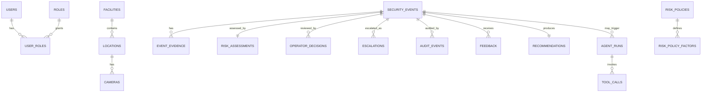

# Gate 3 — SentinelIQ data model

The SQLAlchemy models and Alembic migrations are the executable source of truth. This document is the corresponding ER-equivalent: it records all currently mapped tables, their ownership, and their important relationships without duplicating every implementation column.

## Entity map

## Tables and responsibility

| Area | Tables | Purpose |
|---|---|---|
| Identity | `users`, `roles`, `user_roles` | Local MVP authentication and role assignment. |
| Facility context | `facilities`, `locations`, `cameras` | The physical estate and device catalogue. |
| Event and evidence | `security_events`, `event_evidence`, `risk_assessments`, `confidence_assessments`, `recommendations` | Canonical incoming event, provenance, deterministic assessment, confidence audit record, and operator-facing recommendation. |
| Human oversight | `operator_decisions`, `escalations`, `feedback`, `audit_events` | Human actions, escalation workflow, quality feedback, and immutable-style activity history. |
| Context sources | `access_events`, `schedules`, `deliveries`, `work_orders`, `incident_history`, `security_rules` | Structured context retrieved during assessment. `incident_history` holds historical narratives and optional MVP embedding JSON. |
| Policy and runtime | `risk_policies`, `risk_policy_factors`, `agent_runs`, `tool_calls`, `integration_health` | Versioned scoring policy, agent/tool provenance, and adapter health. |

There are 27 mapped tables: the 26 logical entities mandated by the build prompt plus `confidence_assessments` as a separately auditable operational record.

## Integrity and query design

- Primary keys are UUID strings; mapped records have UTC `created_at` and `updated_at` timestamps through `TimestampMixin`.
- Cascading foreign keys protect event-owned records (`event_evidence`, assessments, recommendations, decisions, escalations, feedback, and audit entries); user-role and facility-location-camera joins are explicit.
- `security_events` indexes the queue’s status/risk and location/timestamp paths. Provider event IDs support deduplication. Context tables index their lookup keys such as location, facility, occurrence time, and source identifiers.
- Provenance belongs with the data: source-system fields or JSON source payloads are retained on contextual records; `EventEvidence`, `AgentRun`, and `ToolCall` retain assessment provenance. Sensitive material must remain redacted before persistence.

## Repository boundary

`app.repositories.SecurityEventRepository` centralizes event lookup, recent-provider-id deduplication, and persistence. `IncidentRepository` provides ordered, bounded historical retrieval. They intentionally do not embed risk policy, lifecycle, or authorization decisions; those stay in services/API layers.
